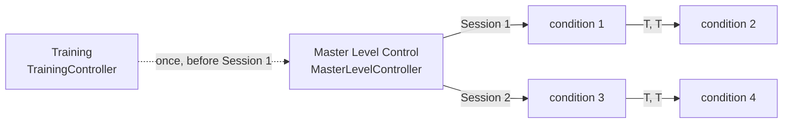
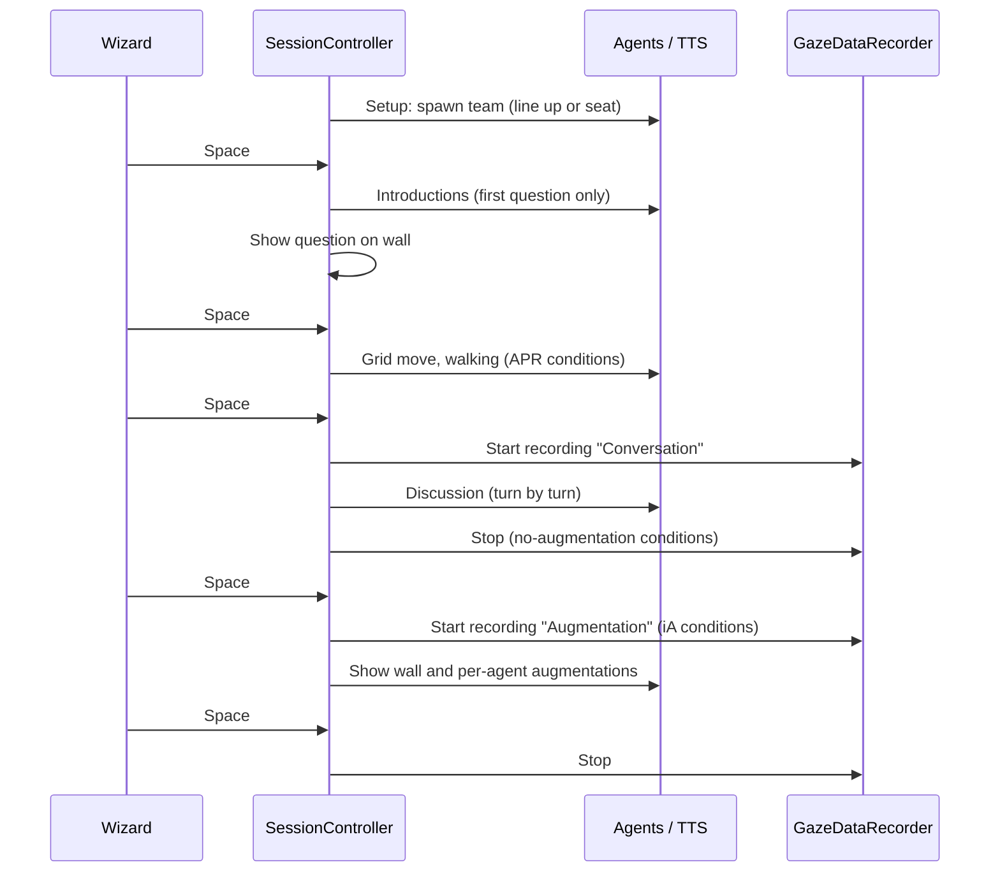

# Architecture

How the testbed's main components fit together. All study scripts are in `Assets/Testbed/Scripts/`, and the editor tools are in `Assets/Testbed/Scripts/Editor/`.

## Scene flow

`MasterLevelController` lives in the entry scene and persists across scene loads. Its start panel takes:

- the participant number, which picks one of four condition sequences: participant *n* runs sequence ((*n* − 1) mod 4) + 1;
- the session (1 or 2), because each participant comes twice and runs two conditions per visit.

It then loads one `Testbed` scene per condition. Each `Testbed` scene contains a `SessionController` that runs that condition's four questions. When a condition ends, the first press of **T** saves its CSV files and clears the room. The second press loads the next condition.

The **Training** scene is a separate entry point that each participant runs once before Session 1. It plays one conversation in `Testbed iAT` and then one in `Testbed iAA`, using a training team and training manuscripts, and logs nothing.

## Components

| Component | Responsibility |
|---|---|
| `MasterLevelController` | Study flow: participant ID, condition sequence, session 1 or 2, avatar teams A–D (each team always plays the same condition), team validation, per-session log folder, resuming after a crash, loading condition scenes |
| `SessionController` | One condition: loads `Resources/Manuscripts/<condition>.json`, checks the scene matches the planned condition, spawns the team's avatars, and runs the phases of each question (Space moves on, Backspace goes back). It also checks that passthrough is running |
| `TrainingController` | The training run: the training team and `Resources/Manuscripts/Training/<condition>.json`, through the study's own iAT and iAA scenes. The participant moves on with X on the left controller |
| `ManuscriptJson` | Reads values from the manuscripts and loads their augmentation images. Each lookup stays inside its own question, so a missing value reads as empty. Shared by `SessionController` and `AgentAugmentationInteracter` |
| `ConversationalAgentsManager` | Plays a conversation: a list of (agent, line) steps spoken one after another |
| `ConversationalAgent` | One avatar: its lines, talking animation, and speech requests |
| `AgentLocomotion` | Plays a Rocketbox walk cycle while an agent is moved to its grid seat, so it steps instead of gliding. It drives the Animator through a temporary PlayableGraph, so no Animator Controller needs editing |
| `CrossPlatformTTS` | Speech synthesis: runs `piper.exe` with the avatar's voice model, caches clips, and normalizes loudness at playback |
| `AgentLipSyncBridge` | Connects the avatar's audio to Oculus LipSync for mouth movement |
| `GridGenerator` | Draws the 5 × 4 opinion grid and converts grid cells to world positions |
| `AgentAugmentationInteracter` | Shows an avatar's AR card when the head ray dwells on it (0.4 s in the testbed scenes) |
| `GazeCursor` | Puts the head-gaze cursor on whatever the head ray hits, sized by distance, so the participant sees it single at the target's depth |
| `GazeDataRecorder` | Detects head-gaze fixations on avatars and the back wall and writes them to CSV |
| `RoomCalibration` | Anchors the virtual room to the physical one. A one-time calibration records two tape marks on the floor, and every scene then moves the camera rig onto Marker A and Marker B. World coordinates are therefore the same in every session |
| `MRUKSceneManager` | Experimental: aligns the floor and wall with the real room via MR Utility Kit (prototype scene only) |

Editor tools in `Scripts/Editor/`:

- the SessionController inspector;
- *Tools → iXR → Assign Proposed Avatar Teams*;
- *Tools → iXR → Bake All Session Audio*;
- *Tools → iXR → Card Text → Draw On Top / Check / Restore Default Material*, which draws the card text on top of the scene so a hand passing in front of a card does not cut into the text;
- *Tools → iXR → Training → Build Training Avatars*, which builds the four training avatar prefabs from the study avatars and assigns them in the Training scene.

`Tools/Training/make_training_content.py` writes the training manuscripts and the iAA training charts. All the numbers in the charts are worked out from the training conversations, so the charts always match what the avatars say.

## One question, phase by phase

## Speech pipeline

1. `SessionController` gives each `ConversationalAgent` its lines from the manuscript.
2. `CrossPlatformTTS` checks its in-memory cache. On a miss, it runs `piper.exe` with the avatar's voice model and speaking-rate setting, and loads the resulting WAV.
3. The clip's speech loudness is measured once, and playback volume is set so every voice plays at the same level (−20 dBFS).
4. Oculus LipSync analyses the playing audio and drives the avatar's mouth.

Each avatar prefab sets its voice file and a calibrated `lengthScale`, so all voices speak at about 4.9 syllables per second. The cache is cleared between conditions.

## Mixed-reality environment

The testbeds are built to be seen with passthrough:

- **Floor.** The virtual floor is not drawn, so the real floor shows. Its collider stays, so the gaze cursor and the logged floor hits still work.
- **Depth occlusion.** An Environment Depth Manager (Meta Depth API, soft occlusion) draws real objects in front of virtual surfaces they are closer than.
- **Occlusion-aware surfaces.** The table, grid lines and label signs use occlusion-aware materials and shaders (`Materials/`, `Shaders/`).
- **Back wall.** A white plane serves as the back wall.

## Study-integrity safeguards

- **Condition check.** A `Testbed` scene halts if its Study Condition differs from what the master sequence expects.
- **Team validation.** Avatar teams are all-or-nothing: if any team is incomplete or shares an avatar with another, team lookup is disabled for every condition, with errors in the Console.
- **Passthrough warning.** The experimenter panel warns when passthrough is not running.
- **Test mode.** When enabled, the wall shows `[TEST MODE]` so it cannot go unnoticed.
- **Resume after a crash.** The start panel can resume a session at a chosen condition and question. The resumed run writes to a new folder, and the earlier folder is left untouched.
- **Data safety.** Each session writes to its own log folder, `<ID>_Seq<n>_S<session>_<start time>`. CSV files are timestamped, and rows are never appended under a header with different columns.